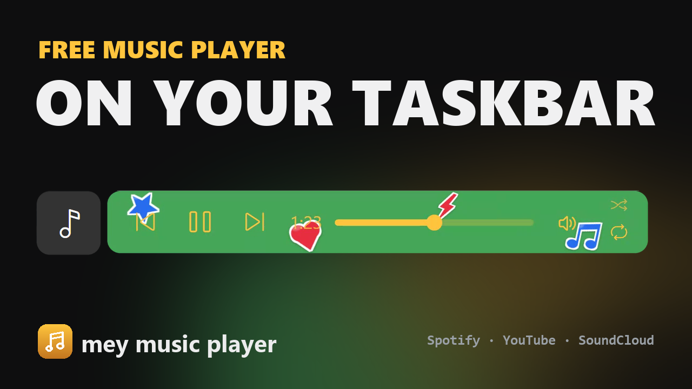
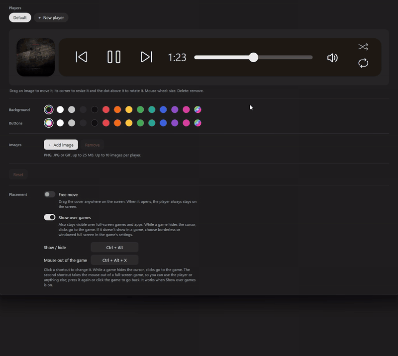
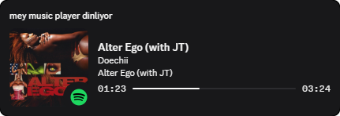

<div align="center">

# mey music player

**A music player you design yourself, on your Windows taskbar and over your games.**


[**Download**](../../releases/latest) · [Website](https://weojiro.github.io/mey-music-player/) · [Türkçe](README.tr.md)

</div>

mey music player (MMP) is a free, open-source music player for the Windows taskbar. It puts the cover of
whatever is playing next to your taskbar icons: Spotify, YouTube in your browser, SoundCloud or any app that
uses the Windows media controls. Click the cover and a small player slides open with the controls, the time
and, for Spotify, the lyrics. It can also show the song on your Discord profile and has a 20-band equalizer.

Make it yours: let it take its colours from the cover, or pick your own colours, make it see-through and add
PNGs or GIFs. Put it anywhere on the screen and keep it visible over full-screen games, where **Ctrl + Alt + X**
gets the mouse out of the game to skip a song.

## Tutorial

[](https://www.youtube.com/watch?v=PsI_AHPoIt4)

## Features

<table>
<tr>
<td width="50%"><br>
<b>A player on the taskbar.</b> Previous, play / pause, next, a seek bar, the volume of the app that is
playing, shuffle and repeat. Drag the cover along the taskbar to put it where you like.</td>
<td width="50%"><br>
<b>Colours from the cover.</b> Every song paints the player in its own colours.</td>
</tr>
<tr>
<td><br>
<b>Lyrics, like in Spotify.</b> The open player shows the line being sung; turn it off under <i>Lyrics</i> in
the tray menu. Move the mouse over it to get the buttons back.</td>
<td><br>
<b>The song's name at a glance.</b> Rest the mouse on the cover for a second.</td>
</tr>
</table>

### Design your player



Open **Options** in the tray menu to make the player your own:

- pick the background and button colours, or keep *Chameleon*, the colours from the cover;
- make the player see-through with the *Transparency* slider: all together, or the background,
  the buttons and the cover one by one;
- add PNG, JPG or GIF images, then drag, resize and turn them on a big preview;
- drag them up or down in the image list to choose which one is in front. They always stay behind the buttons;
- save up to 5 players and switch between them. Everything is saved on its own.

### Anywhere on the screen, even over games

Also in **Options**, under *Placement*:

- **Free move**: drag the cover anywhere on the screen. It keeps its place on the screen, also when a game
  changes the resolution. When it opens, the player always stays on the screen;
- **Player size**: with *Free move* on, make the player bigger, up to 300 %. It stays sharp and on the screen;
- **Show over games**: the player stays visible over full-screen apps and games. If it doesn't show in a game,
  choose borderless or windowed full screen in the game's settings;
- **Show / hide**: press **Ctrl + Alt** to hide or show the player;
- **Mouse out of the game**: press **Ctrl + Alt + X** in a full-screen game to get the mouse out of it, to skip a
  song or use anything else. Press it again or click the game to go back. Works when *Show over games* is on.

Click a shortcut in Options to change it. While a game hides the cursor (driving, aiming), clicks go straight to
the game, not to the player. When the cursor is back (the game's menu), you can use and move the player as usual.

Every saved player keeps its own place: the side, the cover's spot, *Free move*, its size and *Show over games*.
Switch to another player and it comes back just as you left it.

### On your Discord profile

<p>&nbsp;&nbsp;</p>

With *Show on Discord* on (tray menu), your Discord profile shows that you're listening to mey music player: the
song's title, artist and album, a progress bar and the cover with the app's logo in the corner. In the member list, the artist shows under your name. A paused song stays
on the card as "Paused". That works for music apps (Spotify, Apple Music, Deezer, TIDAL, Amazon Music, Media Player, foobar2000
and others) and for music websites in the browser (YouTube Music, SoundCloud and others), also for songs that are only
on SoundCloud. When the cover can't be found, the app's logo shows. Videos and other websites stay private: they show
up as "Something is playing".

### Equalizer

Tray menu → *Equalizer*: 20 bands (the same as AIMP, ±15 dB), a preamp, presets (Flat, Bass, Vocal, Rock, Pop, Treble) and effects (bass boost,
reverb, enhancer, stereo width, balance, reduce vocals). Save up to 5 of your own sounds, and export or import them
as `.mmpeq` files. Changes are heard at once.

It only changes the apps you turn on (Spotify by default; browsers and music players show up while they are open).
Discord, games and everything else sound as they are. For this MMP uses
[VB-CABLE](https://vb-audio.com/Cable/), a free virtual audio cable by VB-Audio (donationware): the Equalizer window
can download its official driver pack (about 1.3 MB, checked before it runs) and install it once. Windows asks for
permission; your default sound devices stay as they are. The equalizer works while MMP is running; when MMP closes or
the equalizer is off, the apps play as before. Equalizer APO, used by v1.3, isn't needed any more.

### Quick controls

| Where | What it does |
|---|---|
| Mouse wheel on the cover | next / previous song |
| Middle click on the cover | play / pause |
| Mouse wheel on the seek bar | 5 seconds back or forward |
| Mouse wheel on the speaker | volume (the mouse on it shows the %); a click mutes |
| Tray icon | a click plays / pauses, the wheel changes the volume |
| Ctrl + Alt | hides / shows the player |
| Ctrl + Alt + X | gets the mouse out of a full-screen game (with *Show over games*) |

In the tray menu, *Position* puts the cover on the right, in the center, center above or on the left. *Center* puts the cover in the middle of the taskbar when the taskbar
icons are on the left, and the open player stays in the middle too. *Center, above* puts it in the middle just above the
taskbar (also with the icons in the middle); over a full-screen game it goes down to where the taskbar is.

## Install

1. Download **MMP.zip** from the [latest release](../../releases/latest).
2. Extract it and double-click **MMP Launcher.bat**. Nothing else needs to be installed.
3. When it says "Installation complete!", start the app with the **mey music player** shortcut on your desktop.

MMP starts with Windows from then on (you can turn that off in the tray menu). It checks GitHub for a new version
when it starts and once a day, and asks you before updating. The new version comes only from this repository's
releases, and MMP checks its SHA-256 before installing it. Works on Windows 10 (1809 or newer, 64-bit) and Windows 11.

## Questions

<details>
<summary><b>Windows says "Windows protected your PC" / unknown publisher.</b></summary>

The app is not signed with a paid certificate. Choose *More info* and then *Run anyway*.
</details>

<details>
<summary><b>Is it safe?</b></summary>

The code is all here. Every release is built from it by GitHub Actions, not on a PC, and comes with its SHA-256.
MMP updates only from this repository's releases, checks the SHA-256 first and asks you before it updates.
</details>

<details>
<summary><b>Which apps does it work with?</b></summary>

Anything that shows up in the Windows media controls (the media box in the volume / quick settings flyout):
Spotify, browsers (Chrome, Edge, Brave, Opera, Firefox) playing YouTube or SoundCloud, and most music and video
players. Lyrics are for Spotify only.
</details>

<details>
<summary><b>The volume doesn't move the slider inside Spotify.</b></summary>

MMP changes the app's volume in the Windows volume mixer, which sounds the same. In a browser, all tabs
share one volume. In Firefox the volume can't be changed from MMP (Firefox doesn't tell Windows which app
it is), but everything else works.
</details>

<details>
<summary><b>My taskbar is on the side or on another screen.</b></summary>

On the taskbar MMP sits on the main screen, at the bottom or the top. Turn on *Free move* in Options to put
it anywhere, on any screen.
</details>

<details>
<summary><b>Something doesn't work.</b></summary>

MMP writes unexpected errors to `%LOCALAPPDATA%\MMP\error.log`. It stays on your PC; attach it when you
[open an issue](../../issues).
</details>

<details>
<summary><b>How do I remove it?</b></summary>

Turn off *Start with Windows* and choose *Close* in the tray menu, then delete the `%LOCALAPPDATA%\MMP`
folder (the app, its settings and your saved players) and the shortcut on your desktop.
</details>

## Languages

English, Türkçe, Español, Français, Deutsch, Português (Brasil), Русский, 简体中文, 日本語, العربية, हिन्दी.
Pick one in the tray menu under *Language*.

## For developers

```
src/        the app (C# / WPF)
launcher/   MMP Launcher.bat + launcher.ps1 (what users download)
tools/      developer helpers
docs/       the pictures in this README
.github/    the workflow that builds the releases
```

`tools/Dev Build.bat` builds the code in `src/` on your PC and starts it (installs the .NET 10 SDK if needed).
`tools/debug.bat` starts the installed app with a debug window.

## Privacy

MMP has no account, no tracking and no analytics. It only connects to these, and sends nothing else:

- **GitHub** (`api.github.com`, `github.com`): checks for a new version at startup and downloads it when you choose
  to update.
- **LRCLIB** (`lrclib.net`): the song's title, artist, album and length, to find lyrics. Only for Spotify, and only while
  lyrics are on (tray menu → *Lyrics*).
- **Discord**: what MMP shows on your Discord profile goes to the Discord app on your PC, which shows it to your
  friends. The song is shown only from music apps and music websites. Turn it off in the tray menu → *Show on Discord*.
- **Deezer** (`api.deezer.com`), **Apple Music** (`itunes.apple.com`) and **SoundCloud** (`soundcloud.com`, only for a
  SoundCloud song): the song's title and artist, to find its cover for Discord (Discord shows a picture only from a web
  address). Only while *Show on Discord* is on.
- **VB-Audio** (`download.vb-audio.com`): VB-CABLE's driver pack, only when you click *Install VB-CABLE* in the
  Equalizer window.

## License

[MIT](LICENSE) © weojiro
