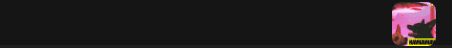
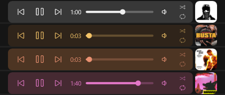
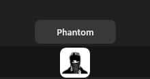
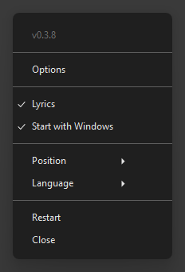

# mey music player

**Dinlediğin şey, Windows görev çubuğunun tam üstünde.**

[**İndir**](../../releases/latest) · [English](README.md)

mey music player (MMP), o an çalan şeyin kapağını görev çubuğuna koyar: Spotify, tarayıcıdaki YouTube
ya da Windows medya kontrollerini kullanan herhangi bir uygulama. Kapağa tıklayınca küçük bir oynatıcı
açılır; butonlar, süre ve Spotify'da şarkı sözleri oradadır. Renklerini kapaktan alır, böylece her zaman
müziğe uyar.

## Özellikler

### Görev çubuğunda bir oynatıcı

Önceki, çal / duraklat, sonraki, ilerleme çubuğu, çalan uygulamanın sesi, karıştır ve tekrarla.
Oynatıcıyı açıp kapatmak için kapağa tıkla, istediğin yere koymak için görev çubuğunda sürükle.

### Kapaktan gelen renkler

Her şarkı oynatıcıyı kendi renklerine boyar.

### Oynatıcını tasarla

Oynatıcıyı kendine göre yapmak için tray menüsünden **Ayarlar**'ı aç: arka plan ve buton renklerini seç
(ya da kapaktan gelen renkler için *Bukalemun*'da bırak) ve üstüne PNG, JPG veya GIF resimler koy. Büyük bir
önizlemede sürükle, boyutlandır ve döndür; resimler hep butonların arkasında kalır, GIF'ler sadece oynatıcı
açıkken oynar. 5 oynatıcıya kadar kaydedip aralarında geçiş yapabilirsin.

### Spotify'daki gibi şarkı sözleri

Tray menüsünden **Şarkı sözleri**ni aç, açık oynatıcı o an söylenen satırı gösterir. Eski satır solarken
yenisi alttan gelir. Butonlar için fareyi oynatıcının üstüne getir. Spotify ile çalışır.

### Şarkının adı bir bakışta

Fareyi bir saniye kapağın üstünde tut.

### Hızlı kontroller

- **Kapakta fare tekerleği:** sonraki / önceki şarkı
- **Kapağa orta tık:** çal / duraklat
- **İlerleme çubuğunda tekerlek:** 5 saniye ileri / geri; **ses ikonunda:** ses; **ses ikonuna tık:** sessiz
- **Tray ikonu:** sol tık çalar / duraklatır, tekerlek sesi değiştirir

### Tray menüsü

Tray ikonuna sağ tıklayınca: Ayarlar, Şarkı sözleri, Windows ile başlat, görev çubuğunun hangi tarafı (sol / sağ),
dil ve Yeniden başlat.

## Kurulum

1. [Son sürümden](../../releases/latest) **MMP.zip**'i indir.
2. Klasöre çıkar ve **MMP Launcher.bat**'a çift tıkla.
3. "Installation complete!" yazınca uygulamayı masaüstündeki **mey music player** kısayoluyla aç.

Launcher eksikse .NET Desktop Runtime 8'i de kurar. MMP bundan sonra Windows ile birlikte açılır
(tray menüsünden kapatabilirsin).

Windows 10 (1809 veya üstü, 64 bit) ve Windows 11'de çalışır.

**Güncellemeler** uygulamanın içinde: açılışta ve günde bir kez yeni sürüme bakar, yenilikleri gösterir
ve tek tıkla kendini günceller.

## Sorular

**Windows "Bilgisayarınız korundu" / bilinmeyen yayıncı diyor.**
Uygulama ücretli bir sertifikayla imzalanmadı. *Ek bilgi*'ye, sonra *Yine de çalıştır*'a tıkla.

**Hangi uygulamalarla çalışıyor?**
Windows medya kontrollerinde görünen her şeyle (ses / hızlı ayarlar menüsündeki medya kutusu):
Spotify, YouTube, X, SoundCloud gibi siteleri çalan tarayıcılar ve çoğu müzik ve video oynatıcı.
Şarkı sözleri sadece Spotify'da.

**Ses butonları Spotify'ın içindeki ses çubuğunu oynatmıyor.**
MMP uygulamanın sesini Windows ses karıştırıcısından değiştirir, kulağa aynı gelir. Tarayıcıda bütün
sekmeler tek bir sesi paylaşır. *Ek bilgi:* Firefox'ta ses MMP'den değiştirilemez (Firefox Windows'a
hangi uygulama olduğunu söylemiyor), geri kalan her şey çalışır.

**İnternete ne gönderiyor?**
Yeni sürüm için GitHub'a bakar. Şarkı sözleri açıksa, sözleri bulmak için Spotify şarkısının adı, sanatçısı,
albümü ve süresi [LRCLIB](https://lrclib.net)'e gider; bulunan sözler `%LOCALAPPDATA%\MMP\lyrics` içinde
saklanır. Başka bir şey gönderilmez.

**".NET eksik" diyor.**
**MMP Launcher.bat**'ı tekrar çalıştır.

## Diller

English, Türkçe, Español, Français, Deutsch, Português (Brasil), Русский, 简体中文, 日本語, العربية, हिन्दी.
Tray menüsünde *Dil*'den seç.

## Geliştiriciler için

Kodun yapısı ve build alma [İngilizce README](README.md#for-developers)'de.

## Lisans

[MIT](LICENSE) © weojiro
