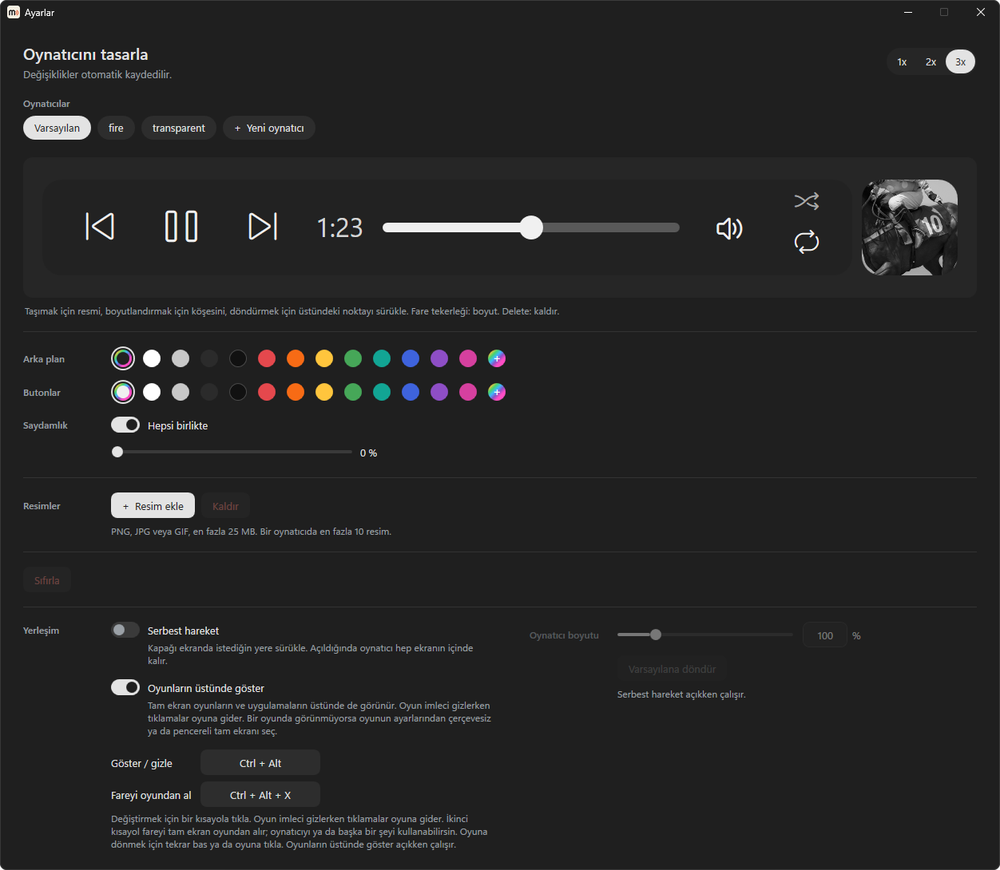
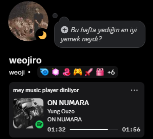
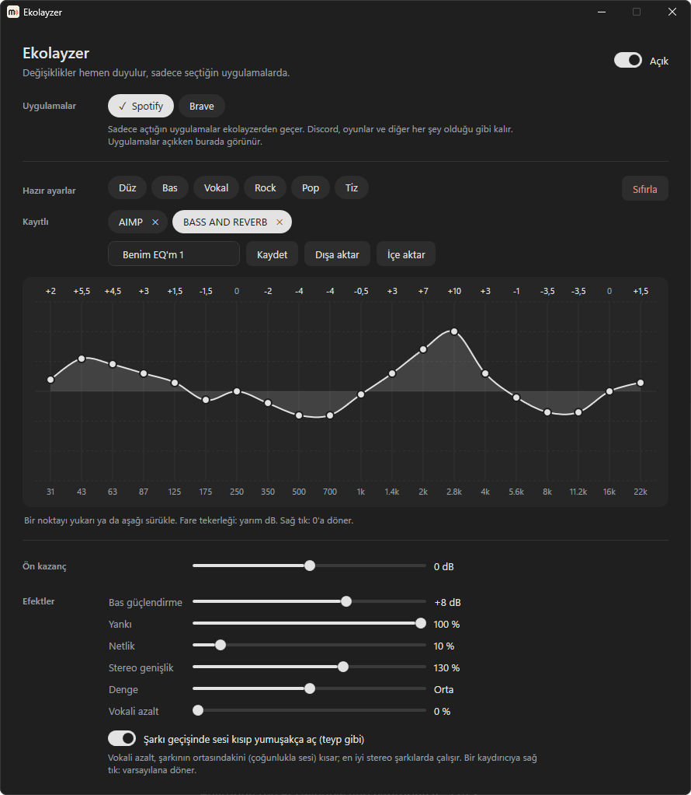

# mey music player

**Kendi tasarladığın müzik oynatıcı: Windows görev çubuğunda, oyunların üstünde.**

[**İndir**](../../releases/latest) · [Web sitesi](https://weojiro.github.io/mey-music-player/) · [English](README.md)

mey music player (MMP), Windows görev çubuğu için ücretsiz ve açık kaynak bir müzik oynatıcı. O an çalan
şeyin kapağını görev çubuğundaki ikonlarının yanına koyar: Spotify, tarayıcıdaki YouTube, SoundCloud ya da
Windows medya kontrollerini kullanan herhangi bir uygulama. Kapağa tıklayınca küçük bir oynatıcı açılır;
butonlar, süre ve Spotify'da şarkı sözleri oradadır. Şarkıyı Discord profilinde de gösterebilir, 20 bantlı bir ekolayzeri de var.

Onu kendine göre yap: renklerini kapaktan alsın ya da kendi renklerini seç, saydam yap, PNG veya GIF ekle.
Ekranda istediğin yere koy, tam ekran oyunların üstünde de görünsün; **Ctrl + Alt + X** ile fareyi oyundan alıp
şarkı geçebilirsin.

## Tutorial

## Özellikler

<table>
<tr>
<td width="50%"> 
<b>Görev çubuğunda bir oynatıcı.</b> Önceki, çal / duraklat, sonraki, ilerleme çubuğu, çalan uygulamanın
sesi, karıştır ve tekrarla. İstediğin yere koymak için kapağı görev çubuğunda sürükle.</td>
<td width="50%"> 
<b>Kapaktan gelen renkler.</b> Her şarkı oynatıcıyı kendi renklerine boyar.</td>
</tr>
<tr>
<td> 
<b>Spotify'daki gibi şarkı sözleri.</b> Açık oynatıcı o an söylenen satırı gösterir; tray menüsündeki
<i>Şarkı sözleri</i>nden kapatabilirsin. Butonlar için fareyi üstüne getir.</td>
<td> 
<b>Şarkının adı bir bakışta.</b> Fareyi bir saniye kapağın üstünde tut.</td>
</tr>
</table>

### Oynatıcını tasarla

Oynatıcıyı kendine göre yapmak için tray menüsünden **Ayarlar**'ı aç:

- arka plan ve buton renklerini seç ya da kapaktan gelen renkler için *Bukalemun*'da bırak;
- *Saydamlık* kaydırıcısıyla oynatıcıyı saydam yap: hepsini birlikte ya da arka planı, butonları ve
  kapağı ayrı ayrı;
- PNG, JPG veya GIF resimler ekle, büyük önizlemede sürükle, boyutlandır ve döndür;
- hangisinin önde duracağını resim listesinde yukarı aşağı sürükleyerek seç. Resimler hep butonların arkasında kalır;
- 5 oynatıcıya kadar kaydet ve aralarında geçiş yap. Her şey kendiliğinden kaydedilir.

### Ekranın her yerinde, oyunların üstünde bile

Yine **Ayarlar**'da, *Yerleşim* altında:

- **Serbest hareket**: kapağı ekranda istediğin yere sürükle. Bir oyun çözünürlüğü değiştirse de ekrandaki
  yerini korur. Açıldığında oynatıcı hep ekranın içinde kalır;
- **Oynatıcı boyutu**: *Serbest hareket* açıkken oynatıcıyı %300'e kadar büyüt. Görüntü bozulmaz, ekrandan taşmaz;
- **Oyunların üstünde göster**: oynatıcı tam ekran uygulamaların ve oyunların üstünde görünür. Bir oyunda görünmüyorsa
  oyunun ayarlarından çerçevesiz ya da pencereli tam ekranı seç;
- **Göster / gizle**: oynatıcıyı gizlemek ya da göstermek için **Ctrl + Alt**'a bas;
- **Fareyi oyundan al**: tam ekran oyunda **Ctrl + Alt + X**'e basınca fare oyundan çıkar; şarkı geçebilir ya da
  başka bir şey kullanabilirsin. Oyuna dönmek için tekrar bas ya da oyuna tıkla. *Oyunların üstünde göster* açıkken çalışır.

Kısayolları değiştirmek için Ayarlar'da üstlerine tıkla. Tam ekran oyunun üstünde tıklamalar oynatıcıya değil oyuna
gider: **Ctrl + Alt + X**'e bas, oynatıcıda çizilen imleçle (buton renginde, yarı şeffaf bir nokta) onu kullan. Tam
ekran oyunun üstünde sözlerin yerinde şarkının adı durur; MPO kapalıysa sözler akar ([Kurulum](#kurulum)'a bak).

Kaydettiğin her oynatıcı kendi yerini hatırlar: taraf, kapağın yeri, *Serbest hareket*, boyutu ve *Oyunların
üstünde göster*. Başka bir oynatıcıya geçince tam bıraktığın haliyle geri gelir.

### Discord profilinde

&nbsp;&nbsp;

*Discord'da göster* açıkken (tray menüsü) Discord profilinde mey music player dinlediğin görünür: şarkının adı,
sanatçısı ve albümü, ilerleme çubuğu ve köşesinde çalan uygulamanın logosu olan kapak. Üye listesinde adının altında sanatçı görünür. Duraklatılan şarkı kartta "Duraklatıldı"
olarak kalır. Müzik uygulamalarında (Spotify, Apple Music, Deezer, TIDAL, Amazon Music, Medya Oynatıcı, foobar2000 ve
diğerleri) ve tarayıcıdaki müzik sitelerinde (YouTube Music, SoundCloud ve diğerleri) çalışır; sadece SoundCloud'da olan
şarkılarda da. Kapak bulunamazsa uygulamanın logosu görünür. Videolar ve diğer siteler gizli kalır: "Bir şeyler çalıyor"
olarak görünür.

### Ekolayzer

Tray menüsü → *Ekolayzer*: 20 bant (AIMP ile aynı, ±15 dB), ön kazanç, hazır ayarlar (Düz, Bas, Vokal, Rock, Pop, Tiz) ve efektler (bas
güçlendirme, yankı, netlik, stereo genişlik, denge, vokali azalt). Kendi seslerinden 5 tanesini kaydedebilir,
`.mmpeq` dosyası olarak dışa ve içe aktarabilirsin.
Değişiklikler anında duyulur.

Sadece açtığın uygulamaları değiştirir (varsayılan Spotify; tarayıcılar ve müzik çalarlar açıkken listede görünür).
Discord, oyunlar ve diğer her şey olduğu gibi kalır. Bunun için MMP, VB-Audio'nun ücretsiz sanal ses kablosu
[VB-CABLE](https://vb-audio.com/Cable/)'ı kullanır (bağış usulü): Ekolayzer penceresi resmi sürücü paketini indirip
(yaklaşık 1,3 MB, çalıştırmadan önce kontrol edilir) bir kez kurabilir. Windows izin ister; varsayılan ses cihazların
aynen kalır. Ekolayzer MMP açıkken çalışır; MMP kapanınca ya da ekolayzer kapalıyken uygulamalar eskisi gibi çalar.

*Şarkı geçişi* açıkken geçilen şarkının sesi kısılır, yenisi yavaşça açılır; araba teybi gibi.

### Yayın penceresi

Tray menüsü → *Yayın penceresi*: kapağıyla şarkı ve sese göre oynayan sütunlar ya da ses dalgası. Discord yayınında
tüm ekran yerine bu pencereyi paylaş: yayına MMP'nin sesi, ekolayzerle birlikte gider. VB-CABLE gerekir (Ekolayzer
penceresinden kurulur).

### Hızlı kontroller

| Nerede | Ne yapar |
|---|---|
| Kapakta fare tekerleği | sonraki / önceki şarkı |
| Kapağa orta tık | çal / duraklat |
| İlerleme çubuğunda tekerlek | 5 saniye ileri ya da geri |
| Ses ikonunda tekerlek | ses (fareyi üstüne getirince % görünür); tıklayınca sessiz |
| Tray ikonu | tık çalar / duraklatır, tekerlek sesi değiştirir |
| Ctrl + Alt | oynatıcıyı gizler / gösterir |
| Ctrl + Alt + X | fareyi tam ekran oyundan alır (*Oyunların üstünde göster* açıkken) |

Tray menüsündeki *Konum*, kapağı sağa, ortaya, orta üste ya da sola koyar. *Orta*, görev çubuğu simgeleri soldayken kapağı görev
çubuğunun ortasına koyar; açılan oynatıcı da ortada durur. *Orta üst*, kapağı görev çubuğunun hemen üstüne, ortaya koyar
(simgeler ortadayken de); tam ekran oyunda görev çubuğunun yerine iner.

## Kurulum

1. [Son sürümden](../../releases/latest) **MMP.zip**'i indir.
2. Klasöre çıkar ve **MMP Launcher.bat**'a çift tıkla. Başka bir şey kurman gerekmez.
3. "Installation complete!" yazınca uygulamayı masaüstündeki **mey music player** kısayoluyla aç.

Launcher ayrıca Windows'un çok katmanlı kaplama (MPO) özelliğini kapatır; böylece oynatıcı ve sözler kenarlıksız tam
ekran oyunların üstünde görünür, kayıtlarda da (NVIDIA Anlık Tekrar gibi) siyah kare olmadan çıkar. Windows bir kez
izin ister ve ayar bilgisayar yeniden başlayınca devreye girer. Geri almak için yönetici olarak açtığın bir terminalde
şunu çalıştırıp yeniden başlat:
`reg delete "HKLM\SOFTWARE\Microsoft\Windows\Dwm" /v OverlayTestMode /f`

MMP bundan sonra Windows ile birlikte açılır (tray menüsünden kapatabilirsin). Açılışta ve günde bir kez
GitHub'da yeni sürüm var mı diye bakar ve güncellemeden önce sana sorar. Yeni sürüm sadece bu repo'nun
release'lerinden gelir ve MMP kurmadan önce SHA-256'sını kontrol eder. Windows 10 (1809 veya üstü, 64 bit) ve Windows 11'de çalışır.

## Sorular

<b>Windows "Windows bilgisayarınızı korudu" / bilinmeyen yayıncı diyor.</b>

Uygulama ücretli bir sertifikayla imzalanmadı. *Ek bilgi*'ye, sonra *Yine de çalıştır*'a tıkla.

<b>Güvenli mi?</b>

Kodun hepsi burada. Her sürüm bir bilgisayarda değil, GitHub Actions'ta bu koddan derlenir ve SHA-256'sıyla gelir.
MMP sadece bu repo'nun sürümlerinden güncellenir, önce SHA-256'yı kontrol eder ve güncellemeden önce sana sorar.

<b>Hangi uygulamalarla çalışıyor?</b>

Windows medya kontrollerinde görünen her şeyle (ses / hızlı ayarlar menüsündeki medya kutusu): Spotify,
YouTube ya da SoundCloud çalan tarayıcılar (Chrome, Edge, Brave, Opera, Firefox) ve çoğu müzik ve video oynatıcı. Şarkı sözleri sadece Spotify'da.

<b>Ses ayarı Spotify'ın içindeki ses çubuğunu oynatmıyor.</b>

MMP uygulamanın sesini Windows ses karıştırıcısından değiştirir, kulağa aynı gelir. Tarayıcıda bütün
sekmeler tek bir sesi paylaşır. Firefox'ta ses MMP'den değiştirilemez (Firefox Windows'a hangi uygulama
olduğunu söylemiyor), geri kalan her şey çalışır.

<b>Görev çubuğum yanda ya da başka bir ekranda.</b>

Görev çubuğunda MMP ana ekranda, altta ya da üstte durur. Ayarlar'dan *Serbest hareket*'i açarsan istediğin
yere, istediğin ekrana koyabilirsin.

<b>Bir şey çalışmıyor.</b>

MMP beklenmedik hataları `%LOCALAPPDATA%\MMP\error.log` dosyasına yazar. Dosya bilgisayarında kalır;
[bir issue açarken](../../issues) ekleyebilirsin.

<b>Nasıl kaldırırım?</b>

Tray menüsünde *Windows ile başlat*'ı kapat ve *Kapat*'ı seç, sonra `%LOCALAPPDATA%\MMP` klasörünü
(uygulama, ayarları ve kaydettiğin oynatıcılar) ve masaüstündeki kısayolu sil. VB-CABLE kurduysan Windows
Ayarlar → Uygulamalar'dan kaldır. MPO'yu geri açmak için [Kurulum](#kurulum)'daki komutu çalıştır.

## Diller

English, Türkçe, Español, Français, Deutsch, Português (Brasil), Русский, 简体中文, 日本語, العربية, हिन्दी.
Tray menüsünde *Dil*'den seç.

## Geliştiriciler için

Kodun yapısı ve build alma [İngilizce README](README.md#for-developers)'de.

## Gizlilik

MMP'de hesap, takip veya analiz yok. Sadece şunlara bağlanır, başka hiçbir şey göndermez:

- **GitHub** (`api.github.com`, `github.com`): açılışta ve sonra günde bir kez yeni sürüm var mı diye bakar, güncellemeyi seçersen indirir.
- **LRCLIB** (`lrclib.net`): şarkı sözlerini bulmak için şarkının adı, sanatçısı, albümü ve süresi. Sadece Spotify'da ve
  şarkı sözleri açıkken (tray menüsü → *Şarkı sözleri*).
- **Discord**: MMP'nin Discord profilinde gösterdikleri bilgisayarındaki Discord uygulamasına gider, o da
  arkadaşlarına gösterir. Şarkı sadece müzik uygulamalarından ve müzik sitelerinden gösterilir. Kapatmak için tray
  menüsü → *Discord'da göster*.
- **Deezer** (`api.deezer.com`), **Apple Music** (`itunes.apple.com`) ve **SoundCloud** (`soundcloud.com`, sadece
  SoundCloud şarkısında): Discord'daki kapak için şarkının adı ve sanatçısı (Discord resmi sadece bir internet
  adresinden gösterebiliyor). Sadece *Discord'da göster* açıkken.
- **VB-Audio** (`download.vb-audio.com`): VB-CABLE'ın sürücü paketi, sadece Ekolayzer penceresinde *VB-CABLE'ı
  kur*'a bastığında.

## Lisans

[MIT](LICENSE) © weojiro
